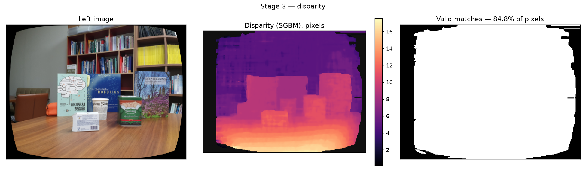
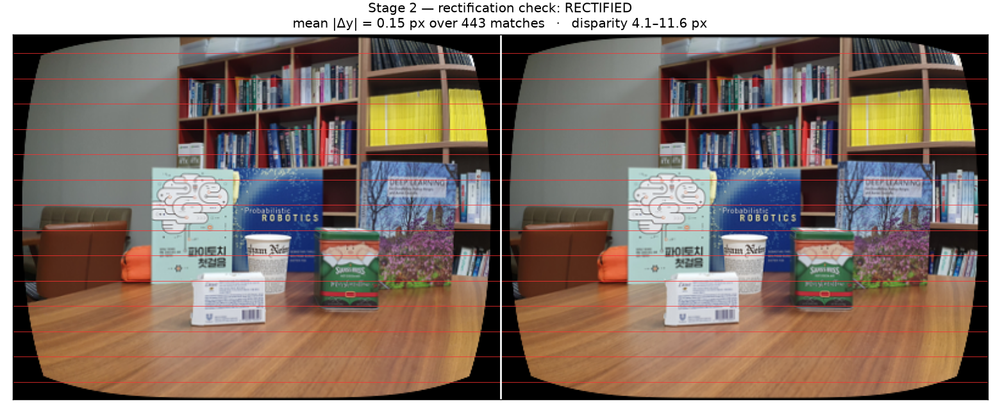
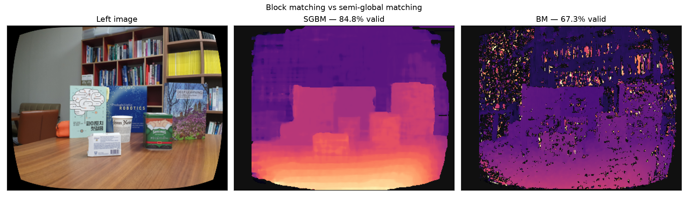
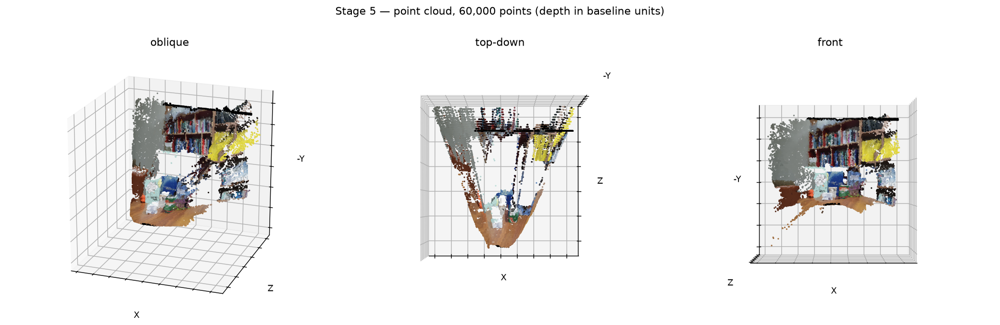

# 3D Reconstruction via Stereo Disparity

Recovers a **dense** 3D point cloud from a single pair of photographs taken
from slightly different positions. A chessboard calibration gives the
intrinsics, block matching along rectified rows gives a disparity for almost
every pixel, and `Z = fx·B/d` turns that into depth.

One pair, 400×300, produces **99,033 points** — against the ~7,500 a
Structure-from-Motion run over 46 views of a different scene recovers. That
density is the whole argument for the method, and it is bought with a
requirement SfM does not have: the two views must be rectified and their
geometry already known.



*Left: the input. Middle: disparity — bright is near. Right: where matching
succeeded. The table reads as near, the books as mid-depth, the shelf as far,
which is the result being correct rather than merely plausible.*

---

### Companion repositories

Three reconstruction methods, each in its own repository:

| | Method | Repository | Recovers | Output |
|---|---|---|---|---|
| **1** | Structure from Motion | [3D-Reconstruction-SfM](https://github.com/mzeeshanvu/3D-Reconstruction-SfM) | poses **and** structure, from images alone | ~7,500 points, 46 poses |
| **2** | 3D Gaussian Splatting | [3D-Gaussian-Splatting](https://github.com/mzeeshanvu/3D-Gaussian-Splatting) | appearance, on top of method 1 | a renderable scene |
| **3** | Stereo disparity | **this one** | dense depth, from a known pair | ~99,000 points |

The trade is the point of comparing them. Method 1 asks only for photographs
and works the geometry out for itself, but returns a sparse cloud. Method 3
returns a depth for nearly every pixel, but cannot start until the geometry
is already known. Method 2 sits on top of method 1 and models what the scene
*looks* like rather than where it is.

---

## Quick start

```bash
python -m venv .venv
.venv\Scripts\python.exe -m pip install -r requirements.txt
.venv\Scripts\python.exe main.py
```

Runs on the included data in about 7 seconds and writes everything to
`output/`. The point cloud is `output/point_cloud.ply` — open it in MeshLab,
CloudCompare, or the Windows 3D Viewer.

```bash
.venv\Scripts\python.exe main.py --compare          # BM and SGBM side by side
.venv\Scripts\python.exe main.py --method bm        # block matching only
.venv\Scripts\python.exe main.py --baseline 0.12    # metric output
.venv\Scripts\python.exe main.py --help             # every option
```

### Using your own images

```bash
python main.py --calibration-dir path/to/chessboards --pattern 9x6 \
               --left path/to/left.png --right path/to/right.png
```

`--pattern` counts **interior corners**, not squares: a board of 10×7 squares
has 9×6 interior corners. The pair must be rectified — stage 2 measures
whether it is and says so rather than letting you find out from a wrong
answer.

---

## How it works

### Stage 1 — Calibration (`stereo/calibration.py`)

Zhang's method on a planar chessboard. The board's corners are coplanar and
evenly spaced, so each view gives a homography, and several views in
different orientations over-determine the intrinsics. Corners are refined to
sub-pixel accuracy first — the calibration is only ever as good as those
coordinates.

On the included set: **RMS reprojection error 0.41 px**, `fx` 308.28,
`fy` 309.44, principal point (199.86, 144.69) — the centre of a 400×300
image, which is the sanity check that it worked.

The square size is left in arbitrary units on purpose. It scales each board's
translation, which this stage discards, and never the camera matrix, which it
returns.

### Stage 2 — Rectification check (`stereo/rectify.py`)

Block matching searches **along image rows**. It assumes corresponding points
share a row in both images. If they do not, the matcher looks in the wrong
place and returns a disparity map that is confidently wrong rather than
obviously broken.

That failure is silent, so this stage measures the assumption instead of
trusting it: match features between the two views, fit a fundamental matrix
with RANSAC to throw out matches that join the wrong instance of a repeated
pattern (a bookshelf is full of them), and look at how far apart the
survivors are *vertically*.

On the included pair: **mean |Δy| = 0.15 px** over 443 inliers. Rectified.
It also measures the horizontal range — 4.1 to 11.6 px — which is what sets
`numDisparities` in the next stage, so that value is derived from the images
rather than guessed.



*Every feature sits on the same red rule in both halves.*

### Stage 3 — Disparity (`stereo/disparity.py`)

Two matchers:

- **StereoBM** slides a window along the row and takes the lowest sum of
  absolute differences. Fast, and decides each pixel independently — so it
  gives up wherever the surface has no texture, which indoors is most of it.
- **StereoSGBM** adds a smoothness penalty aggregated along several
  directions, propagating confident matches into regions block matching
  cannot resolve alone. The default here.

On this pair: **SGBM matches 84.8% of pixels, BM 67.3%.**



Narrow holes are interpolated; wide ones are left empty. A small gap is a
textureless speck. A large one is a genuine occlusion — surface visible to
one camera only — where there is no measurement to recover and filling it
would be fabricating geometry.

### Stage 4 — Depth (`stereo/depth.py`)

From similar triangles, exactly:

```
Z = fx · B / d
```

`fx` is the focal length in pixels, `B` the baseline — the distance between
the two camera centres — and `d` the disparity. Then the pinhole projection
inverts to give the rest:

```
X = (u − cx) · Z / fx        Y = (v − cy) · Z / fy
```

### Stage 5 — Point cloud (`stereo/export.py`)

Back-projection, vectorised over the whole image, then a binary PLY with
per-point colour sampled from the left image. A far cut-off at the 97th
percentile drops the tail: because `Z ∝ 1/d`, the few pixels with the
smallest disparities land arbitrarily far away and would otherwise dominate
the bounding box.



*The top-down view is the one worth reading — the table recedes, the books
stand proud of it, the shelf forms a back plane.*

---

## On the baseline, and what this does **not** recover

`B` is the one term in `Z = fx·B/d` that cannot be recovered from the images.
It is a physical distance between two cameras, and it enters as a pure
multiplier: every X, Y and Z scales linearly with it.

Calibrating a **single** camera on a chessboard — which is what a folder of
chessboard photographs supports — yields `K` and the distortion coefficients
and **no baseline at all**. Getting one needs either a *stereo* calibration,
with the board photographed by both cameras at the same moment, or a ruler.

So this pipeline does not invent a value. With no `--baseline` it reports
depth in **units of the baseline**, `Z/B = fx/d`, which is the complete and
honest result: **the shape of the scene is fully determined; its size is
not.** Supply a measured `--baseline` and the same numbers become metric.

This is the same limitation Structure from Motion has, where the essential
matrix recovers translation only up to scale.

---

## Output

```
output/
├── 01_calibration.png        detected corners, and what they gave
├── 02_rectification.png      the pair with epipolar rules drawn across it
├── 03_disparity.png          input, disparity, and the validity mask
├── 03_disparity_map.png      the disparity alone, 8-bit
├── 03_method_comparison.png  BM vs SGBM          (with --compare)
├── 04_depth.png              the depth map and its distribution
├── 05_point_cloud.png        the cloud from three viewpoints
├── point_cloud.ply           <-- the model
├── point_cloud.xyz           plain text (x y z r g b)
├── stats.json                machine-readable summary
└── run_log.txt               full console transcript
```

---

## What was fixed relative to the original notebook

This replaces an earlier exploratory notebook, which had four defects that
made its depths meaningless. Each is listed here because the failures are
instructive and all four are easy to reproduce:

1. **Disparity was normalised to 0–255 before computing `Z = f·B/d`.** That
   discards the metric disparity entirely — the output is a picture of
   relative depth with numbers attached that mean nothing. Normalising is now
   confined to `disparity.for_display()`, which the arithmetic never touches.
2. **OpenCV's 16× fixed-point scale was never divided out.** Both matchers
   return `16 × disparity` as a 16-bit integer. Skipping the division makes
   every depth 16× too small, and nothing downstream looks wrong enough to
   notice.
3. **Rectification was assumed, never checked.** Now measured and reported,
   with the verdict in the figure.
4. **`baseline = 0.1` was hard-coded and had never been measured.** Now an
   explicit option that defaults to reporting relative depth.

A fifth, less serious: back-projection was a Python loop over every pixel,
running for minutes on a 400×300 image. It is now vectorised and takes
milliseconds.

---

## Requirements

Python 3.8+. Verified on Python 3.14 with OpenCV 4.14, NumPy 2.5,
Matplotlib 3.10. No GPU needed — a full run is about 7 seconds.

---

## References

- Zhang, *A Flexible New Technique for Camera Calibration*, PAMI 2000 — the
  calibration in stage 1
- Hirschmüller, *Stereo Processing by Semi-Global Matching and Mutual
  Information*, PAMI 2008 — the default matcher
- Hartley & Zisserman, *Multiple View Geometry in Computer Vision*, 2nd ed. —
  stereo correspondence (ch. 11), triangulation (§12.2)
- Scharstein & Szeliski, *A Taxonomy and Evaluation of Dense Two-Frame Stereo
  Correspondence Algorithms*, IJCV 2002
